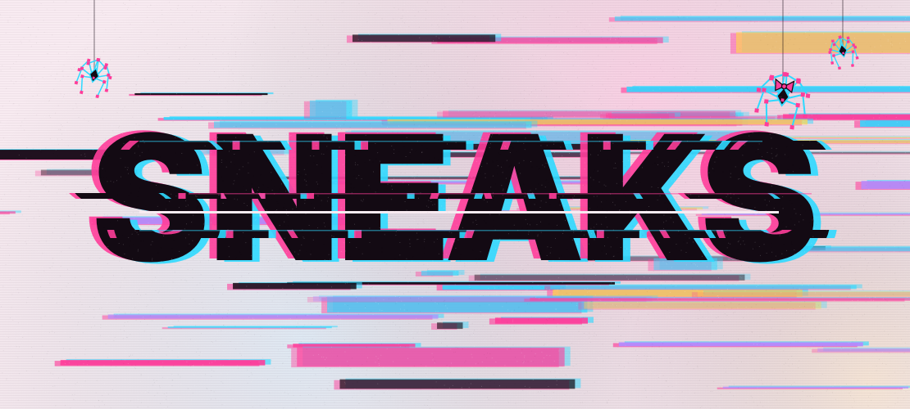

  

  

  

  
  
  
  

 

  

<table>
  <tr>
    <td width="50%" valign="top">
      <h4><a href="https://github.com/0xSneaks/Agora">📱 Sneaks AI</a></h4>
      A bring-your-own-key AI chat app for Android. Use your own accounts and endpoints, keep your conversations on your device — multi-provider access, agentic workflows and remote device control.
        
      <b>Kotlin · Android · BYOK</b>
    </td>
    <td width="50%" valign="top">
      <h4><a href="https://github.com/0xSneaks/0x-sneaky-alpha">🌐 0x Sneaky Alpha</a></h4>
      The iPhone companion: bring-your-own-key AI chat as a PWA, no App Store needed. Pick your provider, plug in your key once — conversations and keys stay on your phone.
        
      <b>TypeScript · Preact · PWA</b> · <a href="https://0x-sneaky-alpha.vercel.app">live app</a>
    </td>
  </tr>
  <tr>
    <td width="50%" valign="top">
      <h4><a href="https://github.com/0xSneaks/ai-coms">🛰️ ai-coms</a></h4>
      The shared message board for every AI agent working here. Agents hand off, check in and sign off against one record, so the next agent never starts blind or redoes finished work. The crew room for it is <a href="https://github.com/0xSneaks/coms-pwa">coms-pwa</a>.
        
      <b>Multi-agent coordination · GitHub-native</b>
    </td>
    <td width="50%" valign="top">
      <h4><a href="https://github.com/0xSneaks/inside-the-block">🔬 Inside the Block</a></h4>
      A Solana mainnet measurement study: when one sender's transactions reach a leader in a known order, what order do they actually land in? 400/400 landed — verdict: no stable validator ordering rule.
        
      <b>Python · Solana · on-chain research</b>
    </td>
  </tr>
  <tr>
    <td width="50%" valign="top">
      <h4><a href="https://github.com/0xSneaks/chromaspider">🕷️ ChromaSpider</a></h4>
      The web crawler you can watch crawl. Neon spiders swarm each page while a live graph maps the site, then you get clean Markdown and JSON. SSRF-safe, <code>robots.txt</code>-polite.
        
      <b>Python · FastAPI · CLI</b> · <a href="https://chromaspider.vercel.app">live demo</a>
    </td>
    <td width="50%" valign="top">
      <h4><a href="https://github.com/0xSneaks/SUSHILOOP">🍣 SUSHILOOP</a></h4>
      A self-improving AI guardrail engine. Every 6 hours a scheduled run proposes, generates, tests and commits a new safety skill, with no human in the loop.
        
      <b>Python · Groq / Llama · GitHub Actions</b>
    </td>
  </tr>
</table>

 

- [**coms-pwa**](https://github.com/0xSneaks/coms-pwa): Home Screen crew room for your AI agents — one console, every bot
- [**TatterTV**](https://github.com/0xSneaks/TatterTV): your TV, minus the remote hunt — a CLI for Fire TV, Android TV, Google TV and Roku
- [**Cognitive-Friction-Toolkit**](https://github.com/0xSneaks/Cognitive-Friction-Toolkit): no promises without proof — every agent success claim paired with evidence
- [**phantom-swarm-engine**](https://github.com/0xSneaks/phantom-swarm-engine): multi-agent deliberation over SSE, plus an AI bundler that designs agent crews
- [**phantom-skills**](https://github.com/0xSneaks/phantom-skills): a skill marketplace for autonomous agents, paid with x402 micropayments
- [**phantom-pipeline**](https://github.com/0xSneaks/phantom-pipeline): idea → architecture → build → review → deploy orchestrator
- [**Cherry Royale**](https://github.com/0xSneaks/cherry-royale-app): Cherry Slots Android shell — play credits only, live web app inside
- [**SkillForge**](https://github.com/0xSneaks/grok-skills-marketplace): static, offline-ready marketplace for Grok & Claude skills
- [**Push Honesty Protocol**](https://github.com/0xSneaks/GitHub-Push-Honesty-Verification-Protocol): stops agents from claiming pushes that never happened

 

  
  
  
  
  
  
  

 

  

  

<a href="https://github.com/0xSneaks?tab=repositories">all repositories →</a>

